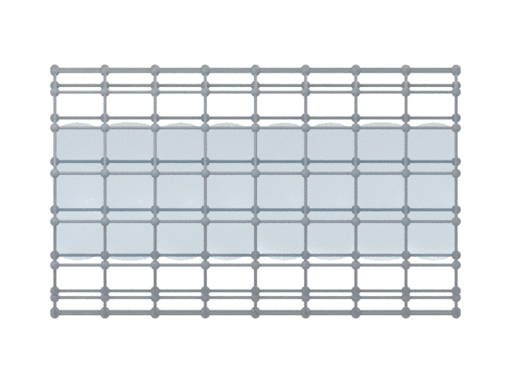

# crystal-pore-blender

Turn a CIF file into a pore surface and an editable Blender scene.

Crystal viewers are good at showing atoms. Showing the space between those atoms usually takes more work, especially when you need a cutaway or want to keep a guest molecule visible. This tool handles the periodic geometry first, then builds a Blender scene you can light, recolor, and edit.

It works with ordered crystal structures, including metal-organic frameworks, covalent networks, zeolites, and molecular crystals. No material-specific atom indices or research structures are bundled. The small example in this repository is a synthetic carbon channel, made only to demonstrate the workflow.

[中文说明](README.zh-CN.md) · [Parameters](references/parameters.md) · [How the geometry works](references/methods.md)



A rendered synthetic example. The surface is calculated from the atomic model, not drawn as a tube.

## Install

Use Python 3.11 or newer. From a downloaded or cloned copy of the repository:

```sh
python -m venv .venv
# macOS / Linux
source .venv/bin/activate
# Windows PowerShell: .venv\Scripts\Activate.ps1
python -m pip install .
crystal-pore-blender doctor
```

For PNG images and `.blend` scenes, install [Blender 4.2 or newer](https://www.blender.org/download/). The command looks for Blender on PATH and in the usual macOS and Windows installation folders. You can also pass `--blender "/path/to/blender"`.

If you prefer to run Blender as a Python module, `python -m pip install '.[render]'` installs the optional `bpy` dependency. Its wheels require a matching Python version and platform. If pip cannot find a wheel, use the standalone Blender application; the geometry package does not depend on `bpy`.

There is no PyPI release of this tool yet. Use `pip install .` from the repository, or install directly from GitHub:

```sh
python -m pip install "git+https://github.com/owenxyzhang-seseTJ/crystal-pore-blender.git"
```

## Try it

After installation, this creates a synthetic channel cutaway without downloading a structure:

```sh
crystal-pore-blender demo --out output/demo --mode cutaway --view side
```

The demo saves its input under `output/demo/input` and its scene under `output/demo/scene`. If the command is missing from PATH, use `python -m crystal_pore_blender` in place of `crystal-pore-blender`.

To use your own CIF with default settings:

```sh
crystal-pore-blender run --cif structure.cif --out output/structure
```

That draws the pores in one unit cell. It does not guess which atoms are solvent or delete any guests. If you only need meshes and calculation files, add `--no-render`; Blender is then unnecessary.

You get transparent and white PNGs, `figure.blend`, raw and display OBJ meshes, a periodic field cache, and JSON records of the parameters and checks. Atom positions come from the CIF, with integer lattice translations for display. Numerical vdW radii and the sizes of displayed atom spheres are separate settings.

## Change the figure

A few useful variations:

```sh
# A smaller probe and finer grid, geometry only
crystal-pore-blender run --cif structure.cif --out output/fine \
  --probe 0.9 --step 0.15 --no-render

# Draw the probe-center boundary instead of the contact surface
crystal-pore-blender run --cif structure.cif --out output/centers \
  --surface probe-center

# Include isolated cavities as well as channels
crystal-pore-blender run --cif structure.cif --out output/cavities \
  --accessibility all

# End view along a specified direct-lattice direction
crystal-pore-blender run --cif structure.cif --out output/end \
  --axis 1 0 0 --view end

# Render an existing mesh again, without repeating the pore calculation
crystal-pore-blender render --display output/structure/display \
  --out output/new-view --style my-style.json

# Process several structures; failed items are recorded in batch.json
crystal-pore-blender batch --cif first.cif second.cif --out output/batch --no-render
```

For a longitudinal or transverse cutaway, set `pore_axis_uvw` in the job or pass `--axis u v w`. A 2D or 3D pore network has no unique channel axis, so the tool asks for your viewing direction rather than inventing one. `--mode cutaway --section transverse` removes the front part of the pore surface with a plane normal to that direction; atoms and guests remain intact.

To change colors, opacity, sphere sizes, resolution, or visible layers, copy [default.json](crystal_pore_blender/styles/default.json) and pass it with `--style`. Common nonmetals have element colors; other elements default to neutral gray. `show_framework`, `show_guests`, and `show_pore` switch complete layers on or off.

## Select guests or a single pore

Start with a configuration and the atom list for your own CIF:

```sh
crystal-pore-blender init --cif structure.cif --out job.json
crystal-pore-blender validate --job job.json
```

`job.intake.json` lists symmetry-expanded source indices, elements, labels, and fractional coordinates. Edit `guest_groups` to remove complete molecules from the pore calculation. `guest_images` controls which of those molecules are still shown in the scene. The groups are unwrapped through a periodic bond graph, so molecules crossing a cell boundary stay together.

The generated job uses a whole-cell display. To isolate one pore, set `display_mode` to `single`, choose `crop_fractional`, and provide a `pore_anchor_fractional` or guest images. The tool checks that those anchors select one component and that the crop does not cut its lateral walls. [The parameter reference](references/parameters.md) includes the exact fields.

Use `framework_mode: "network"` for a bounded view of periodic frameworks. `"molecules"` completes nearby finite molecular fragments; it rejects infinite covalent components. Display bonds are distance-based drawing aids. Check the cutoffs when you need a specific coordination pattern.

## What the surface means

The default `contact` surface bounds the space occupied by a spherical probe after selecting its allowed center positions. `probe-center` draws the allowed-center boundary itself. The default selection keeps periodically percolating center components; `all` also includes isolated geometrically allowed cavities. Those isolated cavities are not automatically accessible from an external gas reservoir.

The grid method records winding vectors and pore dimensionality. It is an approximation at the requested resolution. A coarse grid can miss a narrow window, so refine it before making a numerical comparison. Optional Zeo++ analysis uses an explicit matching radius file and records whether it ran successfully. Neither mesh is described as a native Zeo++ or Mercury surface export.

Partially occupied or disordered structures need an explicitly ordered model. Missing vdW radii need an explicit override. The program does not choose an occupancy model, add hydrogens, move guests, or optimize the structure. See [methods](references/methods.md) for the numerical definition and limits.

## Use it as a Codex skill

The same repository also contains a Skill. Place it under your Codex skills directory, reopen the session, and invoke `$crystal-pore-blender`:

> Use this CIF to make an editable pore cutaway. Keep the guest positions, use a white background, and give me the raw mesh as well.

[SKILL.md](SKILL.md) describes the workflow for the agent. The Python command works on its own.

## Development

```sh
python -m pip install '.[dev]'
python -m pytest -q
python -m build
```

The tests exercise periodic winding, tilted-cell distances, guest unwrapping, CIF occupancy checks, cache matching, and the installed command. GitHub Actions runs them on Python 3.11 and 3.12. They use synthetic structures, not unpublished data.
